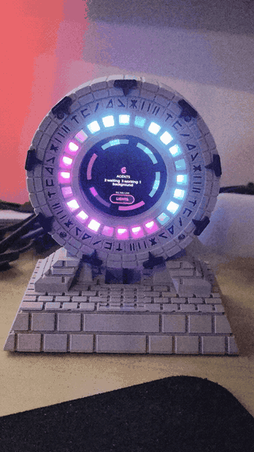

# Stargate Agent Monitor

A desk-sized Stargate that shows, at a glance from across the room, which of
your coding-agent sessions are working and which have stopped and are waiting
on you. A round ESP32-S3 touchscreen sits in the middle of the gate, and a
ring of 24 LEDs lights its inner track. Every live session gets its own arc.



**Supported agents:** [Claude Code](https://code.claude.com/docs/en/hooks)
today, through its native HTTP hooks. Codex and other agents are planned. The
device only needs an HTTP POST carrying a `session_id` and a
`hook_event_name`, so each agent needs a small adapter from its own hook or
notify system. That work hasn't been done yet.

| | |
|---|---|
| **Print it** | STLs and Bambu Studio print profiles: **[MakerWorld](https://makerworld.com/en/models/3533985-stargate-agent-monitor-claude-code-status-light)** |
| **Build it** | Full writeup (parts list, wiring, print guide, 12-step assembly, insert maps): **<https://narcosia.github.io/stargate-agent-monitor/>** |
| **Flash it** | [`console/`](console/): Arduino/C++ firmware for the Waveshare ESP32-S3-Touch-AMOLED-1.75-B puck that runs the screen and the ring |
| **Modify it** | [`enclosure/`](enclosure/): fully parametric OpenSCAD + BOSL2 source, with the decision log in [`enclosure/DESIGN.md`](enclosure/DESIGN.md) |

### What you need

- [Waveshare ESP32-S3-Touch-AMOLED-1.75-B](https://www.aliexpress.com/item/1005009067973350.html), the screen in the middle of
  the gate (AliExpress: choose the **with protective case** option, which the
  enclosure is sized for)
- 24 × WS2812B ring, 72 mm OD / 60 mm ID (built with a [Jaycar XC4385](https://www.jaycar.co.nz/arduino-compatible-ws2812b-rgb-led-circular-strip/p/XC4385))
- [1N5822 Schottky diode](https://www.jaycar.co.nz/diode-1n5822-schottky-40v-3a-do-27/p/ZR1048) + [330 Ω 0.5 W resistor](https://www.jaycar.co.nz/330-ohm-0-5-watt-metal-film-resistors-pack-of-8/p/RR0560), and
  three short [hook-up leads](https://www.jaycar.co.nz/150mm-plug-to-plug-jumper-leads-40-piece/p/WC6024) (all Jaycar NZ)
- 14 × [M2 heat-set inserts](https://www.aliexpress.com/item/1005004837433548.html) and M2 screws (4 × 8 mm pan, 4 × 10 mm countersunk,
  2 × 20 mm pan, 4 × 6 mm pan), plus 1.75 mm filament offcuts for pins
- Filament: grey and black (two-colour glyph front, via AMS), black or red
  (chevrons), translucent PETG (diffuser)

Links go to New Zealand stock, but any equivalent part works. Everything
else, including the exact wiring, is on the
[writeup page](https://narcosia.github.io/stargate-agent-monitor/).

## Ring firmware (MicroPython, repo root)

The repo root holds the original ring-only firmware: MicroPython on a plain
ESP32 driving the LED ring, with no screen. Everything below describes it. The
Stargate build uses [`console/`](console/), which keeps the same hooks,
protocol and state semantics and adds the screen.

Each live session owns an arc of the ring:

| State | Appearance (default `vapor` theme) | Meaning |
|---|---|---|
| **working** | cyan, quick comet | actively processing your turn |
| **background** | violet, slower comet | agents running — wants nothing from you |
| **input** | hot pink, slow pulse | turn finished — awaiting your next prompt |
| **attention** | pink-red, fast pulse | permission prompt or explicit request for input |
| **done** | white, fading out | session ended |
| *no sessions* | single dim pixel creeping round | idle, but powered and connected |

**Motion carries the same information as colour, independently.** Comets mean
"leave it alone", pulses mean "it wants you", and faster means more urgent
within each pair. The ring stays readable in a glance too brief to register hue
— which is what makes `vapor` viable, since its pink `input` and pink-red
`attention` are close enough that the pulse rate does most of the work.

### Themes

Set `THEME` in `config.py`:

| Theme | working / background / input / attention |
|---|---|
| `vapor` *(default)* | cyan / violet / hot pink / pink-red |
| `neon` | cyan / spring green / hot pink / red |
| `classic` | blue / green / amber / red |

`vapor` is the prettiest and the least legible; `classic` is the most legible
and the dullest. A dict overrides individual states, merged over `classic`:

```python
THEME = {"input": (255, 0, 200)}
```

An unknown theme name logs a warning and falls back to `classic` rather than
raising — a typo in config should dim the lights, not take an unattended
device's HTTP server down on boot.

With two sessions running, each gets half the ring; with three, a third. Arcs
are ordered by when the session was first seen, so an arc does not jump
position while you are looking at it.

## How it works

```
Claude Code session ──HTTP POST──► ESP32 ──► WS2812B ring
     (hooks)                    (MicroPython)
```

Claude Code supports a native `"type": "http"` hook that POSTs the event JSON
straight to a URL, so **the ESP32 is the webhook endpoint directly** — there is
no wrapper script, no daemon, and no USB tether. Similar projects
([claude-monitor-esp32](https://github.com/alonw0/claude-monitor-esp32),
[esp32-claude-lamp](https://github.com/reynico/esp32-claude-lamp)) all bridge
through a local script; that turns out to be unnecessary.

Events consumed, from the [hooks reference](https://code.claude.com/docs/en/hooks):

| Hook event | → effect |
|---|---|
| `SessionStart`, `UserPromptSubmit` | working (and resets the pending counter) |
| `Stop` | input |
| `Notification` (`permission_prompt`, `agent_needs_input`, `elicitation_dialog`) | attention |
| `Notification` (`idle_prompt`, `agent_completed`) | input |
| `SessionEnd` | done |
| `SubagentStart`, `TaskCreated` | pending + 1 |
| `SubagentStop`, `TaskCompleted` | pending − 1 |

Every event carries a `session_id`, which is what makes multi-session tracking
work.

### Background work vs waiting on you

A session that spawns background agents stops emitting foreground events. Left
alone, that looks identical to a session sitting idle — so the ring would
report it as wanting your attention when it is simply working. Two mechanisms
prevent that:

**`idle_prompt` is not red.** It means "this session has been quiet a while",
which is exactly what background work looks like from outside. Red is reserved
for notifications that genuinely block: `permission_prompt`,
`agent_needs_input`, `elicitation_dialog`.

**A recency window, not a counter.** The obvious design — increment on
`SubagentStart`, decrement on `SubagentStop` — does not survive contact with
reality: in the field `SubagentStart` was observed firing **once against eleven
`SubagentStop`s**. Matched pairs cannot be relied on, and a counter fed that way
clamps at zero and never engages.

So *any* background event, start or stop, refreshes a `BACKGROUND_HOLD_MS`
window (90 s default). A stream of stops is itself evidence that agents are
running. The counter is kept as corroboration — if it does happen to be
positive, that also counts — but it is never the sole signal.

The window is cleared on `UserPromptSubmit`, which is what releases a session
from green once its agents have genuinely finished and you have replied.

`attention` overrides the window entirely: a permission prompt during background
work is real and does block you.

**Known imperfection:** if a turn's background work finishes and you do not
reply, the arc stays green for up to `BACKGROUND_HOLD_MS` before falling back to
amber. Shortening the window tightens that at the cost of flickering green→amber
→green during quiet stretches between agents.

`GET /` reports `state` (what is drawn), `raw_state` (the last event's state)
and `pending` side by side, and `GET /events` returns the last 40 events, so a
surprising colour can be traced to the event that caused it.

## Hardware

- ESP32 running MicroPython (developed on a Keyestudio ESP32-WROOM-32E)
- 24× WS2812B ring (Jaycar XC4385 or any NeoPixel-compatible ring)
- Ring `Din` → `GPIO13`, `VCC` → `5V`, `Gnd` → `GND`

**Power:** 24 WS2812Bs at full white draw ~1.4 A, roughly triple what USB
supplies. `BRIGHTNESS` defaults to 24 (~9%), which keeps the whole ring near
150 mA at pulse peak. Raise it only with a dedicated 5 V supply whose ground is
tied to the ESP32's.

## Setup

**1. Flash MicroPython** (skip if already done):

```sh
esptool --port /dev/ttyUSB0 erase-flash
esptool --port /dev/ttyUSB0 -b 460800 write-flash 0x1000 ESP32_GENERIC-*.bin
```

**2. Configure:**

```sh
cp config.example.py config.py
$EDITOR config.py        # WiFi credentials, and a static IP if you want one
```

`config.py` is gitignored. Do not commit it.

A static IP is worth setting: the hook URL in `settings.json` is a fixed
string, so a DHCP lease change would silently break the ring until you noticed
it had stopped lighting up.

**3. Deploy:**

```sh
./deploy.sh /dev/ttyUSB0
```

**4. Find the device address.** Attach to the REPL and press RST:

```sh
mpremote connect /dev/ttyUSB0
```

It prints `ring: listening on http://<ip>:80/hook` on boot.

**5. Wire up the hooks:**

```sh
./install-hooks.sh 192.168.1.200
```

Merges the nine hooks into `~/.claude/settings.json`, preserving everything
already there and writing a timestamped backup first. Safe to re-run — it
replaces this ring's hooks rather than stacking duplicates, so changing the
device's IP is just another run. `./install-hooks.sh --remove` undoes it.

To do it by hand instead, take the `hooks` block from
`hooks/settings.snippet.json` and merge it into `~/.claude/settings.json`.

**6. Verify** without involving Claude Code:

```sh
curl -s http://<ip>/                     # current sessions as JSON
curl -sX POST http://<ip>/hook -H 'Content-Type: application/json' \
  -d '{"session_id":"test-1","hook_event_name":"Stop"}'
# one amber arc should start pulsing
curl -sX POST http://<ip>/clear          # forget everything
```

## Multiple machines

Hooks are per-machine configuration — there is no central registry, so **every
computer running Claude Code needs its own hook config**. The device side needs
no changes at all: it accepts any `session_id` from any source, and session IDs
are UUIDs, so sessions from different machines cannot collide. They simply
appear as additional arcs.

On each additional machine, with the repo cloned:

```sh
./install-hooks.sh 192.168.1.200
curl -s http://192.168.1.200/health     # confirm it can reach the ring
```

Requirements for a machine to participate:

- **Same LAN.** The ring is on a private address, reachable only from
  `192.168.1.0/24`. A laptop on mobile data or a different network cannot
  reach it.
- **Do not port-forward the device to the internet.** Hook payloads contain
  prompt text and file paths, there is no TLS, and `TOKEN` travels in
  cleartext. For a machine outside the LAN, use a VPN or an overlay network
  such as Tailscale so the traffic stays private.

**Current limitation:** arcs are ordered by first-seen and carry no per-machine
identity, so with sessions from several computers you can see *that* something
wants attention but not *which machine* it is on. `GET /` lists the session IDs
if you need to disambiguate. Per-host colour tinting is a natural follow-up.

## Endpoints

| Method | Path | Purpose |
|---|---|---|
| `POST` | `/hook` | hook payload from Claude Code |
| `GET` | `/` | session states as JSON |
| `GET` | `/health` | liveness check |
| `GET` | `/events` | last 40 events (metadata only) for diagnosis |
| `POST` | `/clear` | forget all sessions |

`/hook` always answers **200 with an empty body**. This is deliberate: Claude
Code treats a 2xx with a text body as *added context*, feeding it back into the
conversation. A status light must never inject text into your session.

## What this device knows

Hook payloads contain more than session state — `user_input`,
`last_assistant_message`, `message`, `cwd`, and `transcript_path` all arrive in
the POST body. **Only `session_id` and `hook_event_name` are ever read; nothing
is stored or logged.** The console print truncates the session id to 8
characters and names the event, nothing more.

Two things to be aware of regardless:

- **The payloads cross your LAN in plaintext.** MicroPython on an ESP32 is not
  a realistic TLS terminator, so anything with visibility of your network
  segment could read prompt text in transit. On a home network this is
  typically fine; on a shared or untrusted one, it is not.
- **`TOKEN` is a light guard, not security.** It stops another device on the
  network from casually driving your lights. Since it travels in a plaintext
  header, it does not protect the payloads themselves.

## Reliability

- **Ring powered off:** hook connections are refused immediately and Claude
  Code treats that as a non-blocking error. Sessions are unaffected. The
  snippet sets `timeout: 5` rather than the 600s default so an unreachable
  device cannot stall a turn.
- **Sessions that die without `SessionEnd`:** expiry is state-dependent.
  A session still marked `working` that goes quiet for `WORKING_TTL_MS` (1 h)
  is presumed dead — a genuinely working session fires `Stop` eventually, so
  silence means the terminal closed, SSH dropped, or the process crashed.
  Sessions in `input` or `attention` get `SESSION_TTL_MS` (4 h), because they
  can legitimately sit for a long time waiting on a human, and that is exactly
  the state worth showing.

  Pruning is safe either way: an unknown `session_id` is registered on arrival,
  so a wrongly-pruned session reappears the moment it emits any event. That
  makes an over-eager `working` TTL cheap, and a stale arc from a crashed
  session the more expensive failure to avoid. `GET /` reports `expires_in_ms`
  per session if you need to see why an arc is about to disappear.
- **WiFi drops:** re-associated by a background task every 30 s.
- **Device rebooted mid-session:** unknown `session_id`s are registered on
  arrival rather than dropped, so the ring repopulates on the next event from
  each live session.

## Roadmap

Buttons are on order. The intended use is acknowledging an arc — press to
silence a pulsing session you have seen but are not ready to return to, or to
cycle a per-session detail readout. The HTTP server already exposes the session
table needed for that; it will want an input task and a state field for
"acknowledged".

## Files

| File | Purpose |
|---|---|
| `main.py` | HTTP server, event classification, animation loop |
| `ring.py` | LED rendering and per-state arc painters |
| `sessions.py` | session registry, expiry, ordering |
| `wifi.py` | connection and reconnection |
| `config.example.py` | template — copy to `config.py` |
| `deploy.sh` | copy firmware to the board and reset |
| `hooks/settings.snippet.json` | hook configuration to merge |
| `console/` | ESP32-S3 screen + ring firmware (the Stargate build) |
| `enclosure/` | OpenSCAD source for the Stargate and its pedestal |
| `docs/` | the writeup page (GitHub Pages) and its images |

## License

- **Code** (firmware, hooks, scripts, tools): [MIT](LICENSE)
- **Enclosure design** (`enclosure/` models and the printable parts made from
  them): [CC BY-NC-SA 4.0](enclosure/LICENSE.md). Remix it and share it, but
  credit Narcosia, don't sell prints, and share your remixes under the same
  licence.

Stargate is a trademark of MGM. This is an unofficial fan build with no
affiliation. Claude and Claude Code are trademarks of Anthropic; this project
is not affiliated with Anthropic.
